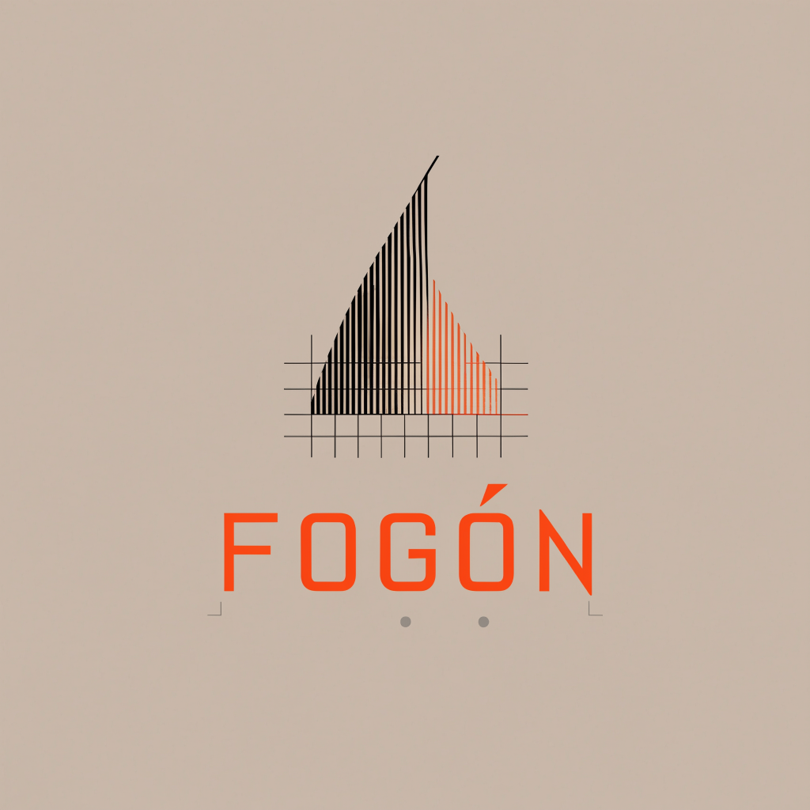
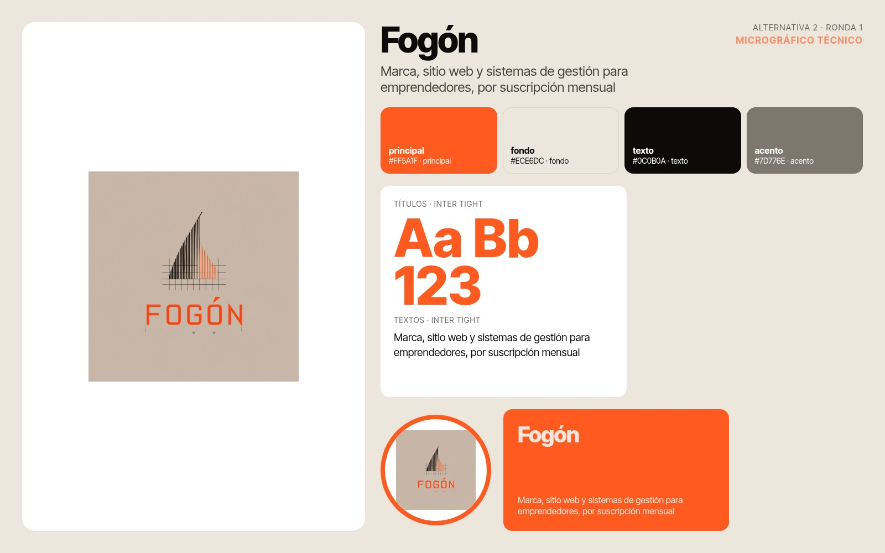

# Identidad de marca: Fogón

Generada con Promo Studio para Fogón. Concepto: **Micrográfico técnico** (Micrographics (Astrae Studio, It's Nice That 2026)).

Inspirado en la precisión técnica de los sistemas de datos. Este concepto organiza la información compleja de las pymes con coordenadas, líneas finas y una grilla limpia, transmitiendo control absoluto, seriedad y escalabilidad sobre el stock, los gastos y las ventas.

## Frase

> Marca, sitio web y sistemas de gestión para emprendedores, por suscripción mensual

## Logo

Un símbolo de fogata abstracta construida enteramente por líneas vectoriales técnicas y pequeños puntos de control, combinada con tipografía monoespaciada.

## Paleta

| Color | Hex | Rol |
|---|---|---|
| — | `#ff5a1f` | principal |
| — | `#ece6dc` | fondo |
| — | `#0c0b0a` | texto |
| — | `#7d776e` | acento |

## Tipografías

- Títulos: **Inter Tight** (Google Fonts)
- Textos: **Inter Tight** (Google Fonts)

